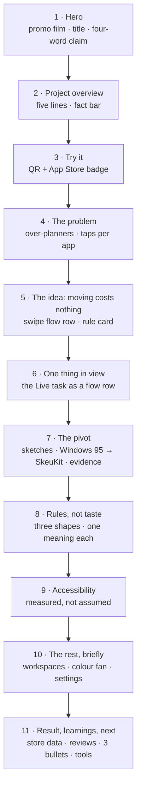

# to.morrow — case study upgrade plan

Plan for turning `public/to.morrow2d.html` into a full case study. Written 2026-09-18 from an
interview with Lucas, **rebuilt 2026-10-24** after two reference case studies by Karen-Happuch:
[Calmsphere](https://karenhappuch.com/calmsphere) and [Asuo](https://karenhappuch.com/asuo)
(analysed in the vault under `04 Ressourcen/Design Referenzen/Einträge/`). The older structural
model is Jason Yuan's write-ups (a spine, research condensed into models, every decision sourced,
captions that carry findings). Voice: **neutral, professional**. Companion to
`unify-casestudy-plan.md`; general guidance in the vault at
`04 Ressourcen/Design & Craft/Case Study Aufbau.md` and in the `case-study` skill.

This file replaces the older content plan (`shove95casestudyplan.md`, 2026-09-03, now deleted —
in git history) that the current page was built from. That plan's description of how the app
works, the research it was based on, the page structure it set and its list of things to avoid are kept as
**Appendices A–D** at the end of this file.

## to.morrow data status · confirmed by Lucas, 2026-10-26

The published case study is `public/to.morrow2d.html`. Lucas explicitly confirms that its
user research, feedback and result statistics are actual findings from real users, not
fictional or placeholder data. The sole exception is the opening competitor comparison:
its app-by-app tap counts and timings are illustrative and must not be described as a
verified user benchmark.

Current results: **3 → 1 actions** to reschedule; **9 of the 15 accompanied/interviewed
participants use Go Live**; **90 total app downloads as of October 2026**. Downloads are
not active users. The 15 participants form one shared user/interview group.

Keep the distinction between user-confirmed facts and independent verification: this
confirmation comes from Lucas. Keep feedback paraphrases labelled as paraphrases and
retain the small-group limitation. Neither implies that the research is fictional.
Do not restore retired draft quantities, retention rates or the replaced active-user count.
Do not invent additional findings or relabel old draft examples as actual results.

---

## Mobile review 2026-10-26: version 2

`public/to.morrow2d2.html`: reviewed the whole page at 320/390/430/744/768/844/859 px with touch emulation, plus 861/1440 px desktop controls. This pass follows the separate rotation, wireflow-edge and sketch-control fixes in `c834a78`.

- Mobile body-copy contrast increased from 2.39:1 to 5.27:1; blue text labels use a darker shade of the existing accent. Reading copy is 16 px, compact explanatory copy 15 px, and Live-sequence labels wrap at 12 px instead of staying at 9.5 px. Source labels retain full opacity.
- The lower Live recordings initially request metadata; a 600 px prefetch margin warms the full sequence before it appears. Desktop retains automatic preloading. Checked hero playback, all three sequence stages, and pausing after scrolling away.
- The document language now follows the existing EN/DE control. Checked both buttons through the nav iframe's existing message path.
- No document-wide horizontal overflow or browser errors in the checks. Desktop section geometry and control dimensions match the baseline. Production build passes. Measurements use headless Chromium with mobile device metrics/touch enabled; no physical-device Safari check was performed.

## Confirmed participant group and current results · 2026-10-26

There is one group of 15 people, accompanied as users and interviewed along their journey.
Nine use Go Live. The app has 90 total downloads as of October 2026; this is a download
count, not an active-user count. The result bar has three cards: 3 → 1 actions, 9 of 15,
and 90 downloads. User research/results are real, as confirmed by Lucas. The opening
competitor comparison is the sole illustrative-data exception.

Retired interview/tester counts and retention rates were removed at Lucas's request and
must not be restored. The keyboard-dismissal text ends at “Dynamic Island”. The current
published page is `public/to.morrow2d.html`; older file-specific entries below are a
historical change record.

## Status 2026-10-24: draft built

`public/to.morrow2d1.html` (same URL with a `1`, unlinked, noindex) implements §2 to §6 as a first pass. Details
and historical layout notes are in CLAUDE.md, "to.morrow case-study rebuild draft". What Lucas added
on top of the plan:

- **A section on the rules of the design system ("what I was thinking")**, section 5 of the page: four rules
  as the reason behind SkeuKit, then the live three-shapes demos, then the shape test (Study 7).
- **A Seitenansicht (side view) sketch inside that section.** Lucas's brief: *"Add a Seitenansicht sketch to
  the hierarchy in the design assets. Side view of the bubble button protruding, the indented input field
  and the combination, explaining what each does."* Built as three cross-section SVGs (bubble · trough ·
  toggle) on a paper-coloured sheet, each with its explanation. **Lucas will draw the paper version; the SVGs
  are the placeholder** and get replaced by the scan.
- **Artwork placeholders:** wireframes and a sketch slot explain the layout until final artwork is available. These visual placeholders do not make user research or results fictional; see the current data status above.

### Still open (Lucas, 2026-10-25)

- [ ] **Re-shoot the two clips under "Live-Benachrichtigungen"** (`live-pair.mp4`, section 3, "Ein Feld, ein Schalter") on the new phone **with Dynamic Island**, so the task can really be ticked off *in* the Dynamic Island. The current clip only shows the Lock Screen.
- [ ] **Add a landscape section to the swipe part (section 2):** in landscape all three panels (Heute, Morgen, Bald) are open at once and you see every to-do of the workspace together. Needs a landscape recording.
- [ ] **Ideas, undecided:** (a) a real interview study with ~20 people on how they track to-dos, repeated with the app afterwards; (b) a three-number fact bar. Neither goes on the page without real data.
- [x] **Done 2026-10-25:** "Die Regel dahinter" card cut (one sentence on date-computed lists moved into "Drei Listen, eine Geste"); section 4 sketch placeholder cut; Pivot cut to 4 Windows screens + same-view comparison + one closing line on the Retro/Modern switch (orbit block and retired retention chart removed); section 5 is now "Das Designsystem" without the four rules (light moved into the Seitenansicht caption).
- [ ] **Optional, section 2:** sketches of the rejected ways to move a task (long-press menu, button, drag), only if real ones exist. Do not draw them after the fact.

The historical work order below is superseded by the current page and confirmed data status above.

---

## Textreview der unverlinkten Seite · 2026-10-26

Überarbeitet wurde ausschließlich `public/to.morrow2d2.html`, einschließlich der englischen
Fassung und der deutschen HTML-Fallbacks. Die verlinkte Case Study und die Unison-Variante
bleiben unverändert. Die bestehenden Zahlen, Zeitmessungen, Quellenzeilen und deutschen
Originalzitate wurden beibehalten. Lucas hat die Nutzerforschung und Ergebniszahlen inzwischen als reale Daten bestätigt.
Nur der einleitende Wettbewerbsvergleich bleibt illustrativ; siehe aktuellen Datenstand oben.

### Befunde und Änderungen nach Position

| Stelle | Problem im bisherigen Text | Änderung |
|---|---|---|
| Auf einen Blick | Allgemeine Aussagen über andere Apps und die Formulierung „die eine Sache, die du nicht vergessen darfst“ verdeckten das konkrete Produktmodell. | Drei Listen, Wischgeste und die ausgewählte Live-Aufgabe direkt benannt. |
| Meta | „Skills“ enthielt vor allem Technologien; das Designsystem stand zusätzlich schon bei der Rolle. Der HTML-Fallback behauptete „laufend“, während die Übersetzung nur den Start nannte. | Rolle als Produktdesign präzisiert, Liste als Tools bezeichnet, Designsystem dort nicht wiederholt. Startdatum in beiden Fassungen angeglichen. |
| Interview-Einstieg | Der letzte Satz berichtete bereits vom Test der fertigen Lösung, bevor die Idee erklärt wurde. | Historische Textverschiebung; diese frühere Ergebnisangabe wurde später auf Lucas’ Wunsch entfernt. Es gelten die aktuellen bestätigten Kennzahlen oben. |
| Problem | „Jede To-do-App“ und „niemand verschiebt“ verallgemeinerten über das beschriebene Material hinaus. „Bediengeschwindigkeit ist das Produkt“ wiederholte später die gleiche These. | Den konkreten Weg über die Datumsauswahl beschrieben und die schnelle Bedienung als Entwurfsziel formuliert. |
| Vergleich | „Competitors“ erklärte weder Aufgabe noch Messgröße. Im Ergebnis wurden fünf Taps mit einem Wisch unter dem gemeinsamen Wort „Taps“ verglichen. | Vergleichsaufgabe als Überschrift; im Ergebnis Aktionen mit unterschiedlichen Gesten benannt. Sämtliche Werte unverändert. |
| Idee | „Ordnung, die nichts kostet“ wiederholte das Problem. „Natürlichste Geste“ und „schneller als jedes Menü“ waren unbegründete Steigerungen. | Direkte Manipulation als Entscheidung erklärt; rechts bedeutet später, links früher. Den Übergang von Heute zu Live konkretisiert. |
| Datum und Querformat | „Rollover“ erklärte eine Implementierung statt des Nutzens. Die Querformattexte blieben auf Deutsch stehen. | Das sichtbare Verhalten am nächsten Tag beschrieben, mit „standardmäßig“ für die vorhandenen Zeitregeln. Beide Querformatfassungen an die Übersetzung angebunden. |
| Live | „Homescreen“ konnte wie ein zusätzliches Widget wirken. „Go Live“ in den Bildunterschriften widersprach dem automatischen Start im Fließtext. | Sperrbildschirm und Dynamic Island als Anzeigeorte benannt. Eingabe, automatischer Start und Sichtbarkeitsschalter getrennt erklärt. Der lokale App-Code bestätigt das Speichern beim Schließen der Tastatur. |
| Einstieg ins Designsystem | Ein allgemeiner Lehrbuchabsatz und die Ankündigung „Hier ist, was ich gebaut und getestet habe“ nahmen viel Raum ein. | Das eigene System und die Wiederverwendung von Elementen im Projekt erklärt; die erste Version direkt an den Screenshots eingeführt. |
| Windows-95-Wechsel | „Es hatte keinen Zweck“ konnte die gesamte App abwerten. Der ästhetische Grund, die Testreaktionen und das neue System waren unscharf verbunden. | Die Aussage auf die Bedienung des alten Looks eingegrenzt. Die persönliche Motivation behalten und die neue Oberfläche vor ihrem Zahlenvergleich benannt. |
| Retro-Einstellung | „Retro und Modern“ ließ offen, ob der Schalter die ganze Oberfläche oder die Schrift verändert. „Sonst sieht die App aus wie jede andere“ erklärte keine Entscheidung. | Optionale Pixelschrift von den weiterhin in Systemschrift gesetzten Aufgabentexten unterschieden. |
| Formen und Seitenansicht | Begründung, Querschnitte und Animationstext erklärten dreimal dieselben drei Funktionen. „Ohne Tippen wählen“ war im Deutschen doppeldeutig. „Höhe liest man am schnellsten“ war eine unbelegte Wahrnehmungsbehauptung. | Begründung = Funktion durch Form; Querschnitt = Aufbau und Licht; Animationen = Verhalten. Umschalter ausdrücklich durch Antippen einer Option erklärt. |
| Barrierefreiheit | Ein einziger Satz bündelte AX5, VoiceOver, Reduce Motion und Touch-Ziele. | Die einzelnen Funktionen in kurzen Sätzen erklärt, Dynamic Type an die iOS-Schriftgröße angebunden. Technische Werte erhalten; kein neuer Nutzertest behauptet. |
| Ergebnis | Kleine Stichprobe wurde mit „kein Befund“ pauschal entwertet. Der Interviewbefund stand an einer früheren Stelle. | Die Grenze als eingeschränkte Übertragbarkeit beschrieben und das Follow-up hier ergänzt. Keine Kausalwirkung des Redesigns behauptet. |
| Reflexion | „Erstens/zweitens/drittens“ und die erneute Beschreibung von drei Formen wiederholten den Hauptteil. | Drei verschiedene Folgerungen: früher Bedienung testen, vorhandene Elemente wiederverwenden, nötige Handgriffe als Entwurfskriterium betrachten. |
| Ausblick | „Wie es weitergeht“ klang nach einem bestätigten laufenden Releaseplan. | Erweiterungen als mögliche nächste Schritte formuliert. Keine Termine oder Versionen hinzugefügt. |
| Sprachen | Interview, Retention, Stichprobenhinweis, Zitate, Ergebnislabels und Querformat waren teilweise nicht übersetzt. | Fehlende Schlüssel ergänzt und wiederholte Bildunterschriften an denselben Übersetzungspfad angebunden. Deutsche Originalzitate unverändert; englische Zitate sind Übersetzungen. |

### Humanizer-Pass

Entfernt wurden pauschale Superlative, dramatische Schlussformeln, wiederholte
„nicht X, sondern Y“-Konstruktionen und satzverbindende Gedankenstriche aus den aktiven Texten.
Die Ich-Perspektive bleibt dort, wo sie eine eigene Entscheidung oder Erfahrung bezeichnet.
Die drei tatsächlichen Formen bleiben als Dreiergruppe erhalten. Technische Implementierungsdetails
wurden durch das sichtbare Verhalten ersetzt, sofern sie keine Gestaltungsentscheidung erklären.

Der deutsche HTML-Text umfasst nach der Überarbeitung 1.303 statt 1.465 Wörter, einschließlich
Beschriftungen und der doppelten Desktop-/Mobil-Alternativen. Das ist keine Wortzahl eines
einzelnen gerenderten Bildschirmverlaufs. Nicht mehr verwendete Übersetzungsschlüssel wurden
bei diesem Review nicht bereinigt.

### Dynamic-Island-Video

Nur diese Seite verwendet nun `public/videos/to.morrow/live-3-island-delayed.mp4`.
In den ersten sechs Frames bei 60 fps ist die eingebrannte Island durch den umliegenden
Bildschirmhintergrund ersetzt. Die leere schwarze Notch kommt aus dem separaten iPhone-Rahmen.
Nach 0,1 Sekunden erscheint die kompakte to.morrow-Anzeige; erst anschließend klappt sie zum ursprünglichen Zeitpunkt auf.
Ab Frame 6 bleibt der Ablauf zeitlich identisch mit dem Original. Gesamtlänge 7,5 Sekunden,
450 Frames und der spätere Abhak-Moment bleiben erhalten. Die Originaldatei bleibt für die
Unison-Variante bestehen.

**Blur-Korrektur, 2026-10-26:** Die schwarze, im Video enthaltene Island wurde zusammen mit
dem Bildschirm unscharf und ragte dadurch als dunkler Hof unter der scharfen Rahmen-Notch hervor.
Nur den kleinen Live-Indikator zu entfernen ließ diese schwarze Fläche bestehen. Jetzt wird in
den ersten 0,1 Sekunden die ganze eingebrannte Island mit `ffmpeg delogo` entfernt; die Rahmen-Notch
bleibt sichtbar und scharf. Blur, Zoom und Abspielsteuerung der Seite wurden nicht verändert.
Der Vergleich derselben Startframes mit 9 px Blur und dem tatsächlichen Rahmen reproduzierte
den Fehler: Helligkeit neben der rechten Notch 78,1/255 gegenüber 201,3/255 beim mittleren Clip.
Nach der Korrektur liegt der rechte Clip bei 193,1/255. Die verbleibende Differenz entspricht
den unterschiedlichen Bildschirmhintergründen. Video-Cacheversion: `v=3`.

Die drei Bildunterschriften stehen jetzt über den Screens anstelle der Zahlen. Die animierten
Verbindungslinien bleiben zwischen den Beschriftungen erhalten; die untere Beschriftungszeile entfällt.

Die drei animierten Designsystem-Beispiele stehen wieder nebeneinander, in gleich breiten
Grid-Spalten und mit einheitlicher Höhe. Die Gruppe nutzt dieselbe volle Inhaltsbreite wie die
Querschnittsabbildung darüber. Der gemeinsame Erklärungstext steht darunter und hat dieselbe Breite.
Die drei Größenfaktoren sind vereinheitlicht; die vorherige Verdoppelung des Live-Schalters entfällt.
Animationen und Reduced-Motion-Steuerung bleiben erhalten. Die Texte sind in Deutsch und Englisch
angebunden; aktuell 96 aktive Übersetzungsschlüssel.
Der mittlere Knopf verwendet jetzt den vollständigen Glasaufbau aus `SkeuGlass` und
`SkeuGlassBackground` der App: fünf weiße Linsenschichten, den unteren Lichtreflex,
vertikales Relief und die weich schattierten Seiten. Diese Fläche sitzt unter Symbol und
Beschriftung; die bestehende Lichtkontur und die äußeren Schatten bleiben erhalten.
Die gewählten 116 % sind für die linke Mulde fest hinterlegt. Der temporäre Größenregler samt
Speicherlogik ist entfernt. Alle drei Elemente bleiben an ihrer gemeinsamen horizontalen
Mittellinie ausgerichtet.

### Prüfung

- Alle 96 aktiven Übersetzungsschlüssel sind in Deutsch und Englisch vorhanden; der bestehende
  Sprachwechsel wurde über den tatsächlichen Message-Handler mit einem minimalen DOM geprüft.
- Alle zwölf Inline-Skripte lassen sich parsen. Zahlenfelder, Vergleichszeiten, deutsche
  Quellenzeilen und die drei deutschen TestFlight-Zitate wurden gegen den vorherigen Stand geprüft.
- Die Änderungen dieser Sitzung bleiben erhalten: volle Breite der sieben Textabsätze,
  mitdrehendes Rotationssymbol und entfernter App-Store-Platzhalter. `noindex, nofollow` bleibt gesetzt.
- Die Anfangsframes des neuen Videos wurden visuell geprüft. Keine Browserprüfung der
  Gesamtdarstellung: Es war kein steuerbarer Browser verbunden.
- Produktionsbuild und `git diff --check` bestanden. Nach Frame 6 folgt das Video dem
  Original mit unverändertem Timing; SSIM nach erneuter Kodierung: 0,999462.

## Wireflows überarbeitet · 2026-10-26

Nur die zwei erklärenden Abläufe auf `to.morrow2d2.html` wurden neu aufgebaut.
Die Referenzen des Nutzers geben die weiß-graue Gestaltung vor. Es sind nachträglich
vereinfachte Darstellungen des aktuellen Verhaltens, keine historischen Entwurfsskizzen.

- **Konstruktion:** konsistente Telefonproportionen, weiße Flächen, graue Gruppen und
  schwarze Konturen; echte Aufgaben und eindeutige Beschriftungen statt Textbalken.
  Gleiche Aufgabe und Navigation über die Zustände hinweg, aktive Liste sichtbar markiert.
- **Verschieben:** Heute → Wisch nach rechts → Morgen → optionales Rückgängigmachen.
  Die drei Aufgaben des Ausgangszustands stimmen mit der Beschriftung überein.
- **Live:** Eingabe mit Tastatur → Sperrbildschirm → geöffnete Dynamic Island → Anzeige
  nach dem Abhaken verschwunden. Tastaturschließen startet Live; ein zusätzlicher
  „Go Live“-Schritt wird nicht behauptet. Sperrbildschirm und Island sind zwei Ansichten
  derselben Aufgabe, keine zwei verpflichtenden Schritte zum Erledigen.
- **Darstellung:** acht Inline-SVGs, über den vorhandenen Sprachwechsel vollständig DE/EN
  übersetzt, einschließlich zugänglicher Bildtitel. Vier Screens nebeneinander; auf schmalen
  Breiten scrollbar statt unlesbar verkleinert. Scrollbereich per Tastatur fokussierbar.
- **Prüfung:** Vektorgrafiken gerendert und visuell geprüft; 131 aktive Übersetzungsschlüssel
  und EN→DE→EN-Sprachwechsel geprüft, zwölf Skripte parsebar, Produktionsbuild erfolgreich.
  Keine Browserprüfung des Gesamtlayouts; kein steuerbarer Browser verbunden.

Grundlage: [NN/g: Wireflows](https://www.nngroup.com/articles/wireflows/) verbindet
Bildschirmzustände mit Aktionen und Feedback; [Figma: What is wireframing?](https://www.figma.com/resource-library/what-is-wireframing/)
beschreibt abgestufte Detailgrade, Inhaltshierarchie und funktionale Struktur vor der
visuellen Ausgestaltung. Hier passt mittlere Detailtiefe: genug echte Beschriftungen zum
Verstehen des Ablaufs, ohne die Materialeffekte des fertigen Produkts nachzubauen.

## Wireframes, Text und Live-Sequenz · 2026-10-26

Aktueller Stand der unverlinkten Version `public/to.morrow2d2.html`:

- Die Wireframes verwenden blaue Konturen direkt an den aktiven Elementkanten
  und S-Kurven zwischen den betreffenden Elementen. Die gezogene Portfolio-Karte
  verlässt den zweiten Screen. Hinzufügen-Felder, detached gesture arrow und
  Home-Indikatoren entfallen; die graue Navigation reicht bis an den unteren Rand.
- Live zeigt Eingabe → Sperrbildschirm → kompakte Island mit Ring → geöffnete Island
  mit markiertem Abhak-Kreis. In der geöffneten Island steht kein App-Name.
- Auf Mobile stehen die Live-Schrittlabels über den Screens. Der Einführungssatz und
  Zusatznotizen entfallen dort. Die Mindestbreiten betragen 176 statt 220 px auf
  Phones und 148 statt 185 px im 641–860-px-Band; dadurch sinkt auch die Layouthöhe.
- Vier Vergleichskarten zeigen Screenshots vor App-Name und vorhandenen Werten.
  Überschrift und Einleitung stehen linksbündig im selben Breitenmaß wie die Karten.
- Das zentrale Entwurfsprinzip ist jetzt ausdrücklich die möglichst geringe Zeit und
  Reibung beim Verwalten von To-dos. Zielgruppe, Live-Begründung und automatische
  Aktivierung nach Tastaturschluss sind in DE und EN überarbeitet. Home Screen wird
  konkret als Dynamic Island auf dem Home-Bildschirm beschrieben. Die Überschrift
  „Die Anzeige steuern“ ist entfernt; der Einleitungstitel lautet „Immer im Blick“.
- Der rotierende Handyblock hat mehr Abstand zwischen Titel und Text. Die Aussage
  „Der Look erschwerte die Bedienung.“ verwendet W95FA bei den bestehenden Maßen.
- Die beiden oberen Fortschrittslinien laufen nach der Videozeit, unabhängig vom
  Pixelpunkt. Linie 1 endet beim Start des mittleren Handys, Linie 2 am Ende seiner
  ersten Abspielphase. Die Clip-Enden wurden auf Bewegung geprüft: konservative
  Stopppunkte 15,10 / 2,50 / 4,25 s. Nach allen Bewegungen inklusive Ankunftseffekten
  steht die Gesamtsequenz noch eine Sekunde und beginnt erneut.

`generate-tomorrow-wireflows.py` erzeugt die zwei Grafiken und ihre Übersetzungen;
`tomorrow-wireflow-connectors.js` verbindet die tatsächlichen Elementkanten nach
Layoutänderungen neu. Die acht Screens und die Gesamtflüsse wurden als SVG gerendert
und visuell geprüft. Laufzeitprüfungen decken Federn, Sprachwechsel, Elementverbindungen
bei Größen-/Scrolländerungen und Sequenz-Timing ab. 129 aktive Sprachschlüssel,
Produktionsbuild und `git diff --check` bestanden. Eine Browserprüfung der gesamten
Darstellung steht aus. Forschungszahlen und Originalzitate wurden unverändert geprüft.

Screenshot-Quellen: Herstellerdarstellungen aus den App-Store-Einträgen
[Reminders](https://apps.apple.com/us/app/reminders/id1108187841),
[Things](https://apps.apple.com/us/app/things-3/id904237743),
[Todoist](https://apps.apple.com/us/app/todoist-to-do-list-calendar/id572688855).
Der to.morrow-Screenshot stammt aus dem vorhandenen öffentlichen Hochformatclip.
Die Hersteller-Screenshots belegen die Vergleichszeiten nicht neu.

Der neue persönliche Skill `wireframes` hält Aufbau, Aktionskonturen, S-Verbindungen,
Mobilverhalten und Prüfregeln fest. Er liegt im bestehenden Skills-Repository und ist
unter `~/.codex/skills/wireframes` für die automatische Auswahl verknüpft.

## Wireframe-Feinschliff · 2026-10-26

- Desktop: beide Abläufe passen mit vier gleich breiten, flüssigen Spalten und
  proportionalen Abständen vollständig ins Band. Mindestbreiten und horizontales
  Scrollen gelten ausschließlich bis 860 px. Doppelte Mobil-Regeln sind bereinigt.
- Verschieben: dunkelgraue gezogene Portfolio-Karte mit weißem Inhalt; die alte
  graue Morgen-Aktionsfläche dahinter entfällt. Der Undo-Pfeil startet am runden,
  blau markierten Symbolknopf, nicht mehr an der ganzen Undo-Karte.
- Live: blauer Ring um das kompakte Island-Symbol mit 40 % größerem Durchmesser.
  Die Abhak-Kreise auf Screen 2 und 4 sind ebenfalls 40 % größer und enthalten Haken.
- Vergleichskarten: quadratische Bildflächen; Außenabstände auf die Hälfte reduziert
  (7–11 statt 14–22 px). Vergleichswerte bleiben unverändert.
- Generierte SVG-Flüsse visuell geprüft; Elementverbindungen und Sprachwechsel geprüft.
  Der persönliche Wireframe-Skill hält statisches Desktop-Layout als Standard fest.

## Freigegebene Vergleichskarten · 2026-10-26

Lucas hat die Darstellung im Screenshot mit voller Abschnittsbreite freigegeben.
Die alte Desktop-Begrenzung auf 66,67 % ist entfernt; Überschrift, Einleitung und
alle vier Karten nutzen dieselbe volle Breite. Die Einleitung übernimmt wie im
Einstellpanel die geerbte Textgröße. Quadratische Bilder, 7–11 px Kartenpolster,
18 px Rundung und bestehende Text-/Zwischenabstände bleiben erhalten.
Das temporäre Einstellpanel samt CSS und JavaScript wurde vollständig entfernt.

## Vollständiger Prompt-Abgleich · 2026-10-26

Der nachgereichte ursprüngliche Auftrag ist in `tomorrow-request-audit.md` Punkt
für Punkt mit dem aktuellen Stand verglichen. Die bereits aktiven fünf
Textänderungen sind nun direkt in den DE/EN-Wörterbüchern hinterlegt; der spätere
Überschreibungsblock und die alten Grundtexte sind entfernt. Die Timer-/Kalender-
Begründung folgt dem Brief enger. Der Nutzer hat den am Ende ohne Ersatztext
stehenden Auftrag mit „just leave it out“ geklärt: die beiden einleitenden
Designsystem-Absätze samt Sprachschlüsseln entfallen. 127 aktive Sprachschlüssel,
Skriptprüfung und Build bestanden; keine Browser-Gesamtprüfung in diesem Abgleich.

## Designsystem-Kapitel neu gefasst · 2026-10-26

Der Abschnitt unter der Windows-Schlussaussage bis zum Ergebnis-Kapitel ist in DE
und EN neu gegliedert: Ziel einer durchdachten, intuitiven Gestaltung → Experimente
mit Formen → drei blaue Listenpunkte für Eingabe-Mulde, erhabenen Knopf und die
Kombination zum Umschalten. Die Erklärungen stehen außerhalb der Skizzenfläche.
Auf dem Blatt bleiben nur die zwei kurzen Notizen „Licht“ und „gleitet“; lange
Überschriften, Tags und Absätze innerhalb des Blatts entfallen. Skizzen und Demos
verwenden jetzt dieselbe Reihenfolge: Eingabe, Knopf, Umschalter. Die bisherigen
15:16-Proportionen gelten weiter auf allen Bildschirmgrößen. Demo-Beschreibung und
Barrierefreiheitsabsatz sind kürzer gefasst. Sprachwechsel, Bewegungslogik, SVG-
Notizumfang und Build geprüft; das vereinfachte Blatt als SVG gerendert und visuell
geprüft. Keine Browser-Gesamtprüfung.

## 0. What the interview established

| Topic | Answer |
|---|---|
| Status | **Live on the App Store** |
| Spine | **Moving costs nothing.** Rescheduling as the primary gesture (see §1) |
| User | **People who over-plan.** Their Today list is always too full, and nothing gets moved |
| Pivot signal | TestFlight users found the Windows 95 build **hard to read**, and **stopped using it** |
| Include | An **accessibility section** (currently zero mentions on the page) |
| Not included | The App Store rejection story, naming the AI-assisted build. Settings and Workspaces stay |
| Craft focus | **The design system's rules** — three shapes, one meaning each. Already on the page, to be strengthened with evidence |
| Voice | Neutral professional |
| Assets | Windows 95 build screens (`windows1–9.webp`), early sketches, the four screen recordings, the promo film (page hero since 2026-10-04) |

## 0.1 What the two references change (2026-10-24)

Both Karen-Happuch pages share one template, and the template is why they read as strong in 30
seconds. Their shared weakness is the opposite of what this plan already does: **neither page
has any evidence.** "Prototype built and refined through user feedback" is their whole
validation, user testing is still listed under next steps, and headline figures carry no
source. So: take their **packaging**, keep this plan's **evidence**. A page with both beats
either reference.

| Asset from the references | Where it came from | Use on to.morrow | Decision |
|---|---|---|---|
| **Project Overview block**: What is it · User problem · My role · What I designed · Outcome or validation | both | Replaces the At a Glance lead, directly under the hero. "Outcome" carries real store numbers, not a vague line | **Take** |
| **Try-it block**: QR code + button | Asuo (TestFlight) | QR to the App Store listing + the existing badge. to.morrow is *live*, which is stronger than her TestFlight beta | **Take** |
| **Screens as flow rows**, each row ending on its outcome screen, on a grey full-width band | Asuo | The Live task as one row: type → Go Live → Lock Screen → Dynamic Island → ticked off. A second row for the swipe: Today → swipe → Tomorrow | **Take** |
| **One rule card**, detail collapsed | Asuo (risk formula, "View full architecture") | The model that runs the app: *a task holds a date; the list is computed from it*, plus the swipe threshold. "How the lists work" expands into the dates diagram. Design logic only, no tech | **Take** |
| **Tab-switchable prototype** under the overview | Asuo (iPhone + Watch, pill tabs) | A working Today / Tomorrow / Soon phone built from the SkeuKit CSS already on the page, where a row can be swiped. It would *be* the spine | **Stretch** (most work, biggest payoff) |
| **Scanned sketchbook spreads** + one design rule as text | Asuo | Opens the pivot with the early sketches. The rule: "one gesture, one meaning" | **Take** |
| **Low-fi → final as separate stages** | both | Only if real low-fi frames exist. Do not draw new ones after the fact | **Only if they exist** |
| **Competitor cards** (strengths/weaknesses) | Calmsphere | Merged into Study 2: the four apps as one bar chart of taps, not four cards | **Fold into Study 2** |
| **2×2 where the product owns a quadrant** | Calmsphere | Rejected on Unify as generic deck material. The taps chart makes the same point with a number | **Skip** |
| **"Why X?" with a dated origin + name meaning** | Asuo | One sentence max: the name is the gesture (to → morrow). Don't open the page with the designer | **One line, in section 3** |
| **Award band** before the title | Asuo | Nothing to put there yet. "Live on the App Store" sits in the fact bar instead | **Later** |
| **Next steps as three bullets, Tools as icon row** | both | Conclusion-4 becomes three bullets; tools as one icon row | **Take** |
| Product-page staging (lifestyle block, colour variants) | Calmsphere | The colour fan already does this. Keep it small | **Already there** |
| Big unsourced "Insights" numbers, empty empathy map, tech-heavy architecture section | both | — | **Never** |

## 1. The spine, in one line

**Why "moving costs nothing" and not the pivot.** The pivot is the strongest *story*, but it is
about the designer. The swipe is the *product insight*: the thing a reviewer should remember
the app by. Yuan does the same in Mercury: the breakthrough is a turning point inside a larger
argument, not the argument itself. So the swipe is the spine and the pivot is the centrepiece
section.

Proposed hero line:

> **to.morrow makes moving a task to tomorrow a single swipe — so the Today list stays
> true, instead of being wrong by mid-morning.**

Asuo's hero shows the pattern for the short form: name, then a four-word claim ("Navigating
Floods. Saving Lives."). Short form for to.morrow, under the title: **"One swipe to tomorrow."**

---

## 2. Target page structure

**The overview block (draft, numbers to fill):**

- **What is to.morrow?** An iOS to-do app with three lists, Today, Tomorrow and Soon, where moving a task to another day is one swipe. On the App Store since `<month year>`.
- **User problem:** People who over-plan fill Today with more than they can do, and moving a task costs enough steps in other apps that nobody does it. By mid-morning the list is wrong.
- **My role:** Solo: concept, interaction and visual design, the SkeuKit design system, and the build.
- **What I designed:** The three-list model and the swipe, the Live task on the Lock Screen and in the Dynamic Island, the SkeuKit component system, workspaces and themes.
- **Outcome or validation:** `<n>` downloads, `<x.x>` stars from `<n>` ratings, `<n> %` of task actions are swipes (Studies 6 and 9).

The last line is where this page beats both references. If the store numbers aren't in yet,
write what is checkable ("Live on the App Store · 2 builds tested on TestFlight · solo") and
nothing vaguer.

What happens to the current sections:

| Current section | Fate |
|---|---|
| Promo film hero | Stays. Title and four-word claim under it |
| At a Glance lead | Becomes the **Project Overview block** + fact bar |
| Top App Store badge (`.appstore-row--top`) | Becomes the **Try-it block**: badge + QR code side by side, one line of text |
| Problem (problem-1…4) | Keep the content; open with the over-planner as the named user; add the taps chart (Study 2) |
| Live notifications (f1, f1b) | Moves **after** the swipe. `live-pair.mp4` stays; above it, the Live flow row as five stills |
| Order that costs nothing (f2, f2b) | Becomes the core section: swipe flow row + rule card + expandable dates diagram |
| Workspaces, Settings (f3, f4) | One compact section, ordered by measured use (Study 6) |
| Pivot (pivot-1…3) | Opens with the sketchbook spread. Keep "there was no reason for it". Replace "the longer I watched" with Studies 4 and 5 |
| Type and icons | Last beat of the pivot: *what survived* (retro mode, chrome only) |
| Drei Formen (dna) | The craft section, with Study 7 as proof |
| Colour ("Not just grey") | Folds into "the rest", one paragraph plus the colour fan |
| Conclusion 1–4 | Keep 1 and 2. **Rewrite 3** (it says nothing concrete). 4 becomes **Next steps, three bullets**. Add the store result and a tools icon row |
| Foot App Store badge | Stays as the closing call to action |

---

## 3. Current evidence and future research

The current user research and results are actual data confirmed by Lucas; see the data
status above. Earlier speculative study programmes, numerical examples and proposed
charts have been removed so they cannot be mistaken for the current evidence record.
The opening competitor comparison retains illustrative app-by-app values.

The next research question on the page is whether a persistently visible task continues
to help completion over time or becomes easy to overlook. This is a proposed follow-up,
not an additional completed study or a measured outcome.

---

## 5. Text changes

- **Voice:** neutral and professional, in both German and English. Replace the personal asides with statements of decision and evidence. Keep the honest core of the pivot ("There was no reason for it"). That sentence is the page's best, and it's neutral already.
- **Overview block, not At a Glance.** Five labelled lines (see §2), bold label + one sentence each. Same `<b>` label idiom the Unify draft's `.guide-text b` already uses. Keys in both `TRANSLATIONS` blocks; check the `@m` twin for `glance-lead` is retired or replaced.
- **Remove the "not X but Y" construction.** It appears repeatedly: "not polish, but the product itself", "not a draw, it was an obstacle", "not out of nostalgia, but because". State the positive claim directly.
- **Rewrite conclusion-3.** "The most interesting part was rethinking something everyday" makes no claim. Replace it with a learning tied to evidence, e.g. from Study 6: speed was measurable, and the median session length became the design target.
- **Name the user** once, early: over-planners.
- **Tie decisions to the real user feedback.** The Retro look became distracting in everyday use, which informed the redesign. Do not restore retired retention figures.
- **Every number gets a source and a timeframe**, printed next to it. This is the lesson of both references: their headline figures are unsourced, and that is what separates a page that reads as researched from one that reads as styled.
- **Distinguish actual results from future research.** Current user findings are real; the proposed Go Live follow-up has not yet produced a result.
- **Page map.** Under the overview, one line announcing the structure: *Problem → Idea → Live → Pivot → System → Accessibility → Result.*
- **Next steps as three bullets** (from conclusion-4: widgets, desktop, and whatever reviews request). Tools as an icon row, one caption.
- **Length:** the page is ~1,030 words now. Adding evidence must not grow it past ~1,100: most studies get one sentence and one visual, and "the rest" shrinks.
- **Both languages:** every changed key in both `TRANSLATIONS` blocks, and the `@m` mobile twins updated where they exist (`glance-lead`, `problem-2`, `f1-text`, `f2b-text`, `f3-text`, `pivot-1`, `dna-forms`, `conclusion-4`).
- **Out, per the interview:** the App Store rejection story and the AI-assisted build.

---

## 6. Visual inventory

| # | Visual | Type | Section | Source |
|---|---|---|---|---|
| 1 | Promo film | Existing | Hero | On the page |
| 2 | **Project overview** five lines + fact bar | Text + big numbers | Below hero | Studies 6, 9 |
| 3 | **Try-it block**: QR code + App Store badge | New, small | Below overview | Generate QR for the store URL; badge exists |
| 4 | Unfinished-task fate | Stacked bar | Problem | Study 1 |
| 5 | **Taps to move one task** | Horizontal bar chart | Problem → idea | Study 2 |
| 6 | **Swipe flow row**: Today → swipe → Tomorrow, ending on the moved state | 4–5 stills on a grey band | Idea | New screenshots from the app |
| 7 | The swipe | Video (`swipe.mp4`) | Idea | Existing |
| 8 | **Rule card**: "a task holds a date; the list is computed", with swipe threshold, expandable into the dates diagram | Card + collapsible step diagram | Idea | Draw |
| 9 | Today list realistic across the day | Two-line chart | Idea | Study 3 |
| 10 | **Live flow row**: type → Go Live → Lock Screen → Dynamic Island → ticked | 5 stills on a grey band | Live | Stills from `live-pair.mp4` / the promo film |
| 11 | The Live task | Video (`live-pair.mp4`) | Live | Existing |
| 12 | **Sketchbook spread** | Photo, full width | Pivot, opening | Existing early sketches |
| 13 | **Windows 95 vs SkeuKit, same screen** | Side-by-side (slider if easy) | Pivot | `windows1–9.webp` + a matching current screen |
| 14 | Retention, two builds | Two-line curve | Pivot | Study 4 |
| 15 | W95FA vs system type | Crop pair + two numbers | Pivot | Study 5 |
| 16 | Three shapes, correct-read rate | Annotated diagram (live SkeuKit components) | System | Study 7 |
| 17 | Default vs AX5 | Side-by-side | Accessibility | Screenshot |
| 18 | Contrast table | Table | Accessibility | Study 8 |
| 19 | Share of task actions | Sorted bar chart | The rest / result | Study 6 |
| 20 | Colour fan | Existing | The rest | On the page |
| 21 | Review cards (2–3) + rating and count | Quote cards in SkeuKit style | Result, Live | Study 9 |
| 22 | Review themes | Sorted bar chart (only with ~20+ reviews) | Result | Study 9 |
| 23 | *Stretch:* **working Today / Tomorrow / Soon phone**, swipeable, pill tabs | Interactive SkeuKit mock | Idea | Build from page CSS; replaces #6–7 if done |

Rules, from the vault guide and the references:
- Motion only where the thing moves. The swipe, the Live task and the pivot's interaction differences are video; charts, diagrams and the side-by-side are stills.
- **Flow rows, not galleries.** Each row is one flow and ends on its outcome screen (Asuo's pattern). Same phone size, same crop, grey band behind, no per-screen labels beyond a caption.
- One message per chart, stated in its caption. Direct labels. to.morrow's bar or line in the accent colour, everything else grey.
- Draw charts in the page's own style (SkeuKit troughs as chart backgrounds would tie them to the system), not pasted from a spreadsheet.
- Collapse depth: anything that explains a mechanism (dates diagram, full design-system rules) sits behind one "show how it works" control, so the 30-second path stays clean.
- 30-second test: headings, captions and visuals alone must tell the story.

---

## 7. Work order

- [ ] **Tier 1 first: Studies 6, 9, 4.** The app is live and the data exists in App Store Connect and TestFlight; together they fill the overview's outcome line, the fact bar, feature order and the pivot
- [ ] Write the **overview block** and the **try-it block** (QR + badge). Both are cheap and are what a reviewer reads first
- [ ] Study 2 (taps benchmark). A single afternoon, and it produces the page's clearest chart
- [ ] Capture the **flow-row stills**: swipe (Today → Tomorrow) and Live (five steps). Same device, same crop
- [ ] Pick the Windows 95 screen whose SkeuKit twin shows the change best; export both at the same crop. Photograph or scan one sketchbook spread
- [ ] Studies 8 and 7 (tier 2)
- [ ] Draw: the rule card and dates diagram, the three-shapes diagram with rates, all charts in the page's style
- [ ] Reorder the page: overview → try it → problem → swipe → Live → pivot → system → accessibility → result
- [ ] Follow up on long-term Go Live visibility when conducting the next study.
- [ ] Rewrite in neutral voice, DE + EN + `@m` twins; remove every "not X but Y"; rewrite conclusion-3; next steps as three bullets, tools as icon row
- [ ] *Stretch:* the working swipeable phone
- [x] User research and results confirmed as actuals by Lucas, 2026-10-26; opening competitor comparison is the sole illustrative-data exception.

## 8. Open questions

1. How many TestFlight testers used each build? The retention curve needs a stated n.
2. Do tester messages about the Windows 95 build still exist? One real quote is worth more than the curve.
3. Is in-app event counting in place, or does Study 6 have to rely on App Store Connect alone?
4. Do real low-fidelity frames or paper sketches of the swipe exist? If not, the pivot opens on the Windows 95 screens alone; nothing gets drawn after the fact.
5. Is the working swipeable phone (§6 #23) worth building? It would be the page's strongest asset and the most work; decide before the flow rows are captured, because it replaces them.

---

## Appendix A. The app, in full

*Moved here from the retired `shove95casestudyplan.md` (written 2026-09-03, when the app was still called shove.95 and ran the Windows 95 look). Check details against the app source before quoting them.*

Reference material. The case study will use a fraction of this — but the
session writing it should know what exists before deciding what to leave out.

### The model

- **Three lists: Today, Tomorrow, Soon.** A task is in exactly one of them,
  always. There is no inbox, no project, no tag, no folder.
- **The lists are filters over a real date, not containers.** Each task holds a
  date (or none); the tab is computed from it. This is the load-bearing
  decision in the whole app — see below.
- **Overdue roll-forward is free.** A past date resolves to Today, so an
  unfinished task simply reappears there with a chip saying how late it is
  ("1 Day", "2 Days"). There is **no rollover job**, no midnight task, nothing
  to go wrong while the phone is asleep.
- **Undated tasks live in Soon**, under a "General" heading.
- Soon also groups dated tasks by day — "Sat 5 Sep", "Sat 31 Oct" — and those
  headings fold shut.

### The swipe — the core gesture

- **Right moves it later** (Today → Tomorrow → Soon), **left pulls it back**.
- The commit threshold is **0.22 of the row's width**, or a release velocity
  over 300 pt/s — so a fast flick commits from a shorter distance than a slow
  drag. The row carries the finger's velocity into the animation.
- Rubber-banding resists at the ends of the line.
- Every move is confirmed by an undo bar that retires itself.

### What you can do to a task

| Gesture | Result |
|---|---|
| Tap the circle | Tick it off — strikethrough, drops to the bottom |
| Tap the text | Inline edit; Return commits |
| Swipe L/R | Move a bucket |
| Long press | Menu: **Delete**, **Go Live**, **Mark as Important**, and a jump to the non-adjacent bucket (`>> Soon` from Today, `<< Today` from Soon) |
| Long press the grip, then drag | Reorder by hand |
| Camera / photo button while editing | Attach a photo |
| Calendar button (Soon only, while editing) | Pick a specific day |

**Important** is red *and* semibold — colour is never the only signal.

### Live — the Lock Screen feature

- A dedicated section, reached by the ring at the bottom left.
- **One live task at a time**, typed into its own large box.
- It appears on the **Lock Screen and in the Dynamic Island** via a Live
  Activity, and stays until ticked off.
- A **Live / Off air** switch controls whether it is showing, without deleting
  the text. A bin deletes it, and greys out when the box is empty.
- Emptying the text ends the live note — the box and the Lock Screen cannot
  disagree.
- **The live task is shared across workspaces.** It is "the one thing you are
  doing", not "the one thing in this list".
- Implemented in a widget extension because that is the only place iOS allows
  Live Activities. **There is no Home Screen widget** and none appears in the
  widget gallery.

### Workspaces

- Separate lists — Personal and Work by default.
- The pill at the top left opens and switches; add, rename and delete live in
  Settings.
- **Deleting a workspace does not delete its tasks** — they fold into the
  default workspace.
- Every query in the app is scoped to the active workspace, so switching swaps
  the entire visible world in one assignment.

### Archive

- A completed **dated** task leaves its list at the **first midnight after
  completion**; a completed **undated** task leaves after **24 hours**. So a
  task you tick at 9am stays visible all day — you can see what you did.
- Grouped by completion day, newest first.
- **Unticking returns it to its bucket** (overdue if the date has passed —
  correct and intended).
- Deleting from the archive is permanent, by design.

### Undo

- Single-level, for **moves and deletes**.
- A status panel reports what happened and retires itself on a timer — it is
  news, not standing chrome.
- The delete snapshot carries the photos, the workspace and the live state, so
  undo restores the task exactly, in the list it came from.

### Photos

- **Several per task**, shown as thumbnails in the row.
- Attached from the library or the camera; downscaled on import.
- The viewer supports **pinch and double-tap zoom**, and **Live Text**
  (VisionKit) — so you can select a phone number or address out of a
  photographed label.
- Swipe down to dismiss the viewer; swipe a photo away to delete it.

### Settings

| Panel | What it offers |
|---|---|
| **Theme** | Four — Slate, Cream, Moss, Rose. Each derived from a single seed colour rather than hand-picked. |
| **Light & dark** | System / Light / Dark |
| **Typeface** | **Retro** (W95FA pixel type on chrome, readable system face for task text) or **Modern** |
| **Tab names** | Rename all three tabs, with a Default reset. Bounded length so the bar cannot break. |
| **Workspaces** | Add, rename, delete |
| **Data** | Archive, How to use, About |
| — | A one-line iCloud status |

### Sync and privacy

- **SwiftData + CloudKit private database.** No account, no login, no email, no
  server belonging to the developer.
- Works fully offline; syncs when it can.
- A remote-change observer means a task added on another device appears
  without a manual refresh.
- **Zero third-party dependencies.** No analytics, no crash reporter, no SDKs
  of any kind.

### Help, instead of onboarding

- **There is no first-run walkthrough** — it was built, then deleted.
- Instead, a **How to use** screen with three blocks: Go live, Swiping,
  Workspaces. Two of the three illustrations are the **real controls, running**
  — the Live switch toggling itself, the workspace pill opening and switching —
  rather than drawings of them. The third animates two task rows being shoved
  off the screen.

### Accessibility

- Dynamic Type through **AX5**; chrome scales at half the rate of text so
  controls do not swallow the screen.
- The tab that stops fitting **abbreviates** ("Tomorrow" → "Tmw") rather than
  shrinking, so all three labels stay the same size.
- **VoiceOver custom actions** for edit, reorder and photos — the row collapses
  to a single element, so without them those three were unreachable.
- **Reduce Motion** stops every looping animation dead rather than slowing it.
- 44pt touch targets throughout.

### Platform and stack

- **iOS 18+**, portrait only.
- SwiftUI, SwiftData, CloudKit, ActivityKit (Live Activities), VisionKit (Live
  Text), WidgetKit.
- `Shove95Kit` — a local Swift package holding the date engine, bucket model
  and placement logic, with **56 unit tests** covering rollover, archive
  visibility, timezone changes and non-Gregorian calendars.
- `SkeuKit` — the in-app design system: tokens, palettes, depth primitives
  (trough, glass, bloom), one press behaviour.

### Debug affordances (not shipped behaviour)

`-seedDemo YES` fills a clean install with presentable content,
`-seedFillers YES` adds 40 rows for scroll testing, `-wipeAll YES` empties
every workspace. Useful for producing screenshots.

---

---

## Appendix B. Research on case-study length and scanning

*From the retired shove.95 plan, 2026-09-03.*

Sources: AppFollow, Screenhance, Design Decade, MyUX Academy, UX Playbook (2026).

**The numbers that shape everything:**

- Recruiters spend **30–60 seconds** on a first portfolio scan and **5–10
  minutes** on a first case study. Everything essential must survive the
  30-second version.
- An **800-word case study where every sentence counts beats a 4,000-word one**
  that buries its insights.
- Hiring managers judge a portfolio by its **weakest** case study, not its best.
  Three to five strong ones is the target.

**What they are actually looking for:**

They are not looking for prettier screens than the last candidate. They are
looking for evidence you can **identify a problem, make defensible decisions,
and move a product toward an outcome**. Process and rationale outrank final
screens.

**The canonical structure:** overview → problem → role → research and insights
→ process → key decisions with rationale → final solution → outcomes.

**Presenting a personal project with no metrics** (directly relevant here):
substitute three things for numbers — a sharply defined problem, explicit
decision rationale, and honest lessons learned. Answer "what problem, who
benefits, what actually changed" clearly and the absence of a funnel chart
stops mattering.

---

---

## Appendix C. The page structure the current page was built from

*From the retired shove.95 plan, 2026-09-03. This is how `to.morrow2d.html` is laid out today; §4 of this file is the planned replacement.*

Eight sections. Roughly 900–1100 words of prose total — every section should be
cuttable to two paragraphs.

### 1 — Hero + one-liner

The 30-second version lives here. A single sentence that states the problem and
the answer.

> A to-do app where moving a task to tomorrow takes one swipe instead of six
> taps.

Plus the meta grid, matching Unify's:

| Field | Value |
|---|---|
| **Timeline** | Aug 2026 – ongoing |
| **Role** | Concept, product design, design system, build |
| **Team** | Solo |
| **Platform** | iOS 18+, SwiftUI, SwiftData + CloudKit |
| **Status** | Submitted to the App Store |

### 2 — The problem

The strongest paragraph in the case study and the one that must survive the
30-second scan. It is already written, in `docs/VISION.md`:

> Task apps make *creating* a task cheap and *rescheduling* it expensive.
> Moving an item from today to tomorrow means opening it, finding a date
> picker, choosing a date, and saving — so people stop doing it. Every task
> collapses into one undifferentiated "today" list that is mostly lies by 11am.

The original motivation came from Lucas’s own workflow. The current case study also
includes the real 15-person user/interview group; do not describe its evidence as n=1.

### 3 — The one idea

The insight the whole app follows from: **rescheduling should be the primary
gesture, and everything else should be deliberately ordinary.**

Then the model, in three lines: three buckets, a task is always in exactly one,
swipe right pushes it later and left pulls it back. Include the detail that the
buckets are *filters over a real date* rather than folders — so nothing needs a
rollover job and an unfinished task simply reappears with a day chip. That is a
systems decision a reader can respect.

### 4 — The pivot *(the centrepiece)*

Give this the most room.

- **What v1 was:** a complete Windows 95 interface at 2× pixel scale — taskbar
  navigation, bevelled controls, status bar with persistent undo, W95FA type
  throughout. Genuinely finished, not a mood board.
- **Why it went:** the joke was louder than the app. A pixel-faithful 1995
  interface is a costume; it made a daily tool tiring, fought every iOS
  convention, and the retro-computing audience it flattered was not the
  audience that would use it every morning.
- **What replaced it:** SkeuKit — a soft-skeuomorphic system built from tokens,
  four themes in light and dark, depth from light rather than texture.
- **What survived:** the pixel typeface, kept as an optional "Retro" mode that
  applies to chrome only while task text stays in the system face. The idea
  did not have to die for the interface to.

Show both. A side-by-side of the old Windows 95 build and the current one is
the single most valuable image on the page.

### 5 — Design system

Short, evidenced, no lecture.

- Four themes × light/dark, derived from one seed colour each rather than
  hand-picked.
- Depth comes from light: troughs for recesses, glass for controls, plain text
  on the ground for content.
- One press behaviour for every control in the app.
- Named contrast floors: 6.4:1 body text, 3.4:1 for decorative, with one
  documented exception taken deliberately.

### 6 — Craft details

Two or three, no more. Pick the ones that are hard and invisible:

- **The swipe carries velocity.** Release position alone would make a flick and
  a drag feel identical; the release velocity projects where the row is going.
- **The three-bucket line is one-dimensional on purpose** — right is later,
  left is earlier, no grid to learn.
- **The live task** sits on the Lock Screen via a Live Activity, so the one
  thing you are doing does not need the app open to be seen.

### 7 — Accessibility

A short, factual list. This section will do more for a hiring manager than
another screenshot.

- Verified at the largest Dynamic Type size; the tab that stopped fitting
  abbreviates rather than shrinking, so all three labels stay one size.
- VoiceOver: an audit found edit, reorder and photos unreachable because the
  row collapses to a single element — added as custom actions.
- Reduce Motion stops every looping animation dead rather than slowing it.
- Contrast measured, not eyeballed, and one deliberate trade recorded in
  writing.

### 8 — Shipping it, and what it taught

Where the honesty lands.

- Submitted to the App Store; **rejected under Guideline 2.1 — Information
  Needed.** Say plainly what that is: the App Review Information section was
  left blank, so the reviewer could not complete a review. Not a quality
  finding. Resubmitted with reviewer notes and a demonstration recording.
- **Lessons, three at most.** Candidates:
  - Finishing an interface is not the same as validating it — the Windows 95
    build had to be complete before it was obvious it was wrong.
  - Constraint beat capability: cutting the fourth bucket made the gesture
    explainable in one sentence.
  - Accessibility found real bugs, not just compliance items — three row
    actions were genuinely unreachable and nobody had noticed.

---

---

## Appendix D. What to avoid

*From the retired shove.95 plan, 2026-09-03.*

- **Do not open with the aesthetic.** The retro look is the hook on a design
  community, not on a hiring manager. Problem first.
- **Preserve the real research record.** Current user research/results are confirmed by Lucas; never add unsupported personas, interviews or metrics. A plainly stated sample is stronger than a
  fake study, and reviewers spot the difference instantly.
- **Do not bury the pivot** in a "challenges" section at the bottom. It is the
  best evidence of judgement on the page.
- **Do not explain SwiftUI.** The reader is hiring a designer.
- **Do not pad.** If the page needs a scroll bar longer than Unify's, cut.

---

## Competitor screenshots and supplied counts · 2026-10-26

The selected comparison is Google Tasks (3 taps, IMG_9771), Apple Reminders
(3 taps, IMG_9772), Todoist (3 taps, IMG_9773), Microsoft To Do (4 taps, IMG_9764),
and to.morrow (1 swipe). Lucas supplied the app names/counts in a Notes screenshot.
IMG_9775 is excluded following his choice of four competitors plus to.morrow.
The four competitor screenshots are format-converted to WebP without altering their UI;
CSS crops retain approximately 80% of the screen height and prioritise date controls.
Desktop uses five equal columns; mobile uses a 2×2 competitor grid with to.morrow
centered below at the same card width. Old timing values and Things imagery are removed
from the current comparison. The Reminders result summary is now 3 → 1 to match the supplied
count. This records Lucas’s comparison, not an independently verified timed user study.

### Mobile comparison crops · 2026-10-26

At ≤640 px, image frames use 40:49 instead of 4:7, exactly 70% of their prior
height at the same width. Per-app crop positions retain the date controls. For
to.morrow, two clipped views of the same screenshot remove unused space between
the task list and navigation, preserving the swipe gesture and full bottom nav.
The source screenshot and desktop crop are unchanged.

### Final comparison crop refinement · 2026-10-26

Desktop frames now use 400:539, 77% of the previous 4:7 height with widths unchanged.
Mobile retains 40:49. The mobile to.morrow list crop is anchored at 51% to remove
the clipped circle at its top edge; the separate bottom-nav crop remains intact.
An 8% blue-gray overlay slightly darkens and tints only the to.morrow screenshot
on both layouts, without changing the source asset.

## Eigene Querschnittsskizze eingesetzt · 2026-10-26

Lucas’ Scan `~/Downloads/Gescanntes Dokument 2.pdf` ersetzt die drei künstlichen
SVG-Zeichnungen auf der veröffentlichten Seite. Die PDF-Seite wurde um 90° im
Uhrzeigersinn gedreht und auf den Bereich (20, 300)–(2417, 1188) der gedrehten
Seite beschnitten. Ergebnis: 2397×888 px, etwa 2,7:1; alle drei Zeichnungen und
Pfeile bleiben erhalten. Nur Blattrand entfernt, keine zeichnerische Ergänzung.
Webasset: `public/images/to.morrow/seitenansicht-skizze.webp`; Desktop und Mobile
zeigen denselben vollständigen Ausschnitt. Die Bildbeschreibung ist DE/EN.
Die frühere offene Aufgabe „Skizze liefern/einsetzen“ ist damit erledigt.

Nach Lucas’ Sichtprüfung: beim Rendern aus dem Original-PDF zusätzlich um 0,6°
gegen den Uhrzeigersinn ausgerichtet, damit die rechte Seite nicht absinkt.
Finales Webasset: 2407×914 px, ca. 2,63:1. Keine Linien nachgezeichnet, keine
Perspektivkorrektur einzelner Formen; nur die leichte globale Neigung korrigiert.
